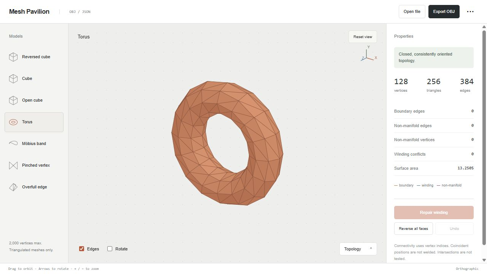

# Mesh Pavilion

A triangle-mesh inspection gallery with indexed topology diagnostics, boundary loops, orientability constraints, face-winding repair, an orbitable preview, and portable OBJ/JSON evidence.



## Interface

The desktop editor opens directly to the model viewport. Choose examples in the left model list, orbit the mesh in the center, and inspect or repair it from the right properties panel. **Topology** opens a lower panel with keyboard-navigable Surfaces, Edges, and Diagnostics tabs. Export formats are grouped in the top toolbar. On narrow screens, the model list becomes a dropdown and properties follow the viewport.

The canvas renders at its current size and device pixel ratio (capped at 2). A coordinate-axis indicator rotates with the camera; the dotted background is a screen-space guide, not a world-space measurement grid.

## Run

```sh
python run.py --port 8000
```

Open http://127.0.0.1:8000. Python 3.10+ serves an allowlist of browser assets. Geometry analysis runs locally in a module worker; Node 22+ runs the dependency-free tests. No external service, account, GPU API, or runtime package installation is needed.

## The collection

| Example | What it demonstrates |
| --- | --- |
| Cube / a reversed face | Three inconsistent shared-edge directions; one face flip restores consistent winding |
| Cube / closed | 8 vertices, 18 edges, 12 triangles, Euler characteristic 2, genus 0, area 24, signed volume +8 |
| Cube / open roof | Four boundary edges forming one loop; Euler characteristic 1; genus 0; no volume reported |
| Torus | 128 vertices, 384 edges, 256 triangles; Euler characteristic 0 and genus 1 |
| Möbius band | Manifold vertex neighborhoods, one boundary loop, and contradictory orientation constraints; repair disabled |
| Pinched vertex | Two face components meet at a single bad vertex, even though no edge has more than two incident faces |
| Overfull edge | Three faces share one edge; the endpoints also fail their vertex-link checks |

[Reversed-face OBJ](docs/example.obj) · [Repaired OBJ](docs/repaired-cube.obj) · [Möbius OBJ](docs/mobius.obj)


## Interactions

- Open triangle OBJ or mesh JSON files; choose a built-in surface from the collection.
- Drag to orbit; arrow keys rotate; `+`/`−` zoom. Reset view restores the camera. Optional slow orbit starts only when enabled; it is off by default.
- Inspect edge/face/vertex counts, surface area, boundaries, overfull edges, bad vertex links, duplicate triangles, degenerate triangles, and unused vertices.
- Browse classified edges in pages of 12. Select an edge to highlight it and list its incident face IDs.
- **Make winding consistent** applies the computed face flips without moving coordinates. **Reverse all faces** changes the global winding. Undo retains up to 20 mesh-operation states; opening a file or selecting a collection example starts a new history.
- Export the current OBJ, mesh JSON, complete analysis JSON, or 1000×700 PNG preview. Imported texture/normal/material metadata is not preserved.

The default reversed cube suppresses signed-volume reporting until its winding is consistent. Repair restores approximately +8. Reversing all faces gives approximately −8; consistency does not establish an outward direction.

## Topology model

Connectivity is defined by vertex **indices**, not positions. Coincident coordinates remain separate; the app does not weld vertices or test intersections. Face components connect through shared edges, so two sheets meeting only at a vertex remain separate face components while that shared vertex is diagnosed globally.

Each undirected edge retains directed incident-face records. One incident face is a boundary; more than two is non-manifold. Two faces traversing the edge in the same direction have a current winding conflict.

For each used vertex, its link graph connects the other two vertices of every incident triangle. A valid neighborhood has one connected link that is either a cycle (interior) or a path with exactly two degree-one endpoints (boundary). Disconnected or branching links are non-manifold. Duplicate indexed face triples are reported independently and block manifold classification/repair. Geometrically coincident triangles with distinct indices are not duplicate indexed triples.

For each face component, a parity traversal solves whether neighboring faces must have equal or opposite flip bits. Contradictions make a manifold component non-orientable. For non-manifold components, the `orientable` output is `null`: surface orientability is not reported. The Möbius example exercises a genuine orientation contradiction rather than merely inconsistent input winding.

Boundary edges form undirected loops only when all boundary-graph vertices have degree two. Loop arrays repeat the starting vertex at the end; their traversal direction is not an outward-orientation claim. Euler characteristic uses only the component’s used vertices, edges, and faces. For a manifold orientable component, genus is `(2 − boundaryLoops − Euler)/2`. These are invariants of the indexed combinatorial surface, even when its geometric embedding is degenerate or self-intersecting.

For orientable manifold components, the parity assignment and its complement describe the two globally consistent windings. Repair chooses the one flipping fewer faces; ties preserve the seed face. If any component is non-manifold or non-orientable, the whole repair action is disabled. Repair does not split vertices, remove faces, close holes, resolve intersections, or select an outward direction.

## Geometry and rendering limits

Area sums triangle cross-product magnitudes. A triangle is flagged degenerate when the cross-product magnitude is at most `1e-12 * largestSquaredEdgeLength`. Signed volume is computed only for closed, manifold, orientable, currently consistent components without degenerate faces. It sums tetrahedral contributions relative to a component reference vertex to reduce translation-related cancellation. Floating-point roundoff remains; self-intersections and nested-shell semantics are not handled. Volume is an algebraic diagnostic, not a physical-solid certification.

The canvas uses orthographic projection, flat shading, and a painter’s depth order. It can misorder intersecting or overlapping triangles. Problem edges are overlaid for inspection, including hidden-side edges. Camera operations do not alter geometry. Unused vertices are counted but excluded from preview fitting and component invariants. The preview is diagnostic, not a rendering benchmark.

## File contract and bounds

Mesh JSON uses `{"format":"mesh-pavilion-v1","vertices":[[x,y,z],...],"faces":[[i,j,k],...]}` with zero-based indices. The UI displays IDs one-based.

Bounds are 3–2,000 vertices, 1–4,000 triangles, three distinct valid indices per face, coordinates within ±1,000, and 1 MB imports. Triangle degeneracy is reported rather than rejected. OBJ faces must be triangles and reference vertices already defined, using positive one-based or negative relative vertex indices. Common `v/vt`, `v//vn`, and `v/vt/vn` token forms are accepted; texture/normal references are ignored, not resolved. `v` must contain exactly three coordinates. `vt`, `vn`, `o`, `g`, `s`, `usemtl`, and `mtllib` lines are ignored and reported; external materials are never loaded. Other directives, quads, n-gons, repeated face indices, and out-of-range references are rejected. Invalid imports retain the current mesh.

Evidence JSON contains the normalized mesh, all edge incidences, vertex-link classifications, normals, areas, component invariants, boundary loops, orientation conflicts, and repair plan. It is an analysis format, not the mesh-import schema. OBJ export preserves coordinate values and vertex indices but serializes fresh text without input comments/materials.

## Verification

```sh
npm test
npm run check
python -m unittest discover -s tests -v
```

Nine JavaScript tests check analytic cube area/volume, open-surface boundary loops, torus genus, Möbius non-orientability, pinched vertices, overfull edges, OBJ relative-index round trips, malformed imports, unused vertices, duplicates, degeneracy, and translated disconnected components. Every one of the **4,096 cube face-winding assignments** is repaired and checked for consistent shared-edge direction and absolute volume 8. A Python HTTP test verifies the local asset allowlist, Host validation, CSP, HEAD, and response lengths. CI runs Ubuntu with Node 22/24 and Windows with Node 24, using Python 3.13.

Browser checks covered keyboard orbit/zoom, edge selection, pagination across the torus’s 384 edges, optional orbit, winding repair, reversal/undo, non-orientable repair rejection, invalid polygon rejection, and repaired-OBJ import. Independent Python calculations verified the downloaded cube’s 12 triangles, 18 oppositely directed shared edges, Euler characteristic 2, area 24, and volume 8 within floating-point tolerance; mesh JSON and OBJ agreed, and the PNG dimensions matched the canvas.

References: [CGAL polygon mesh processing: orientation and manifold repair](https://doc.cgal.org/5.6.3/Polygon_mesh_processing/index.html), [Polthier: Introduction to Polyhedral Meshes](https://page.mi.fu-berlin.de/polthier/articles/habil/polthier-habil2002.pdf). Mesh Pavilion implements its own bounded indexed-triangle algorithms and does not use CGAL.

`core.js` owns parsing and topology; `worker.js` isolates analysis; `app.js` handles files, camera, inspection, and export; `run.py` serves only browser assets. There are no data uploads or telemetry calls.

The editor redesign was browser-checked at desktop and 390-pixel widths: model selection, keyboard rotation, topology tab keys, edge highlighting, repair, undo, and panel dismissal. All nine geometry tests remain passing.
